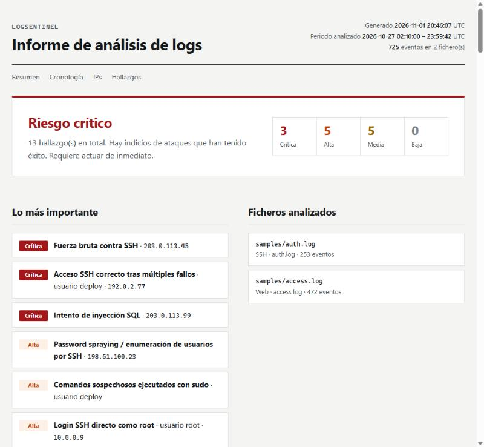

# LogSentinel

Herramienta de línea de comandos que analiza logs de **SSH** (`auth.log`) y de **servidores web** (nginx / Apache), detecta ataques habituales, los relaciona con técnicas de **MITRE ATT&CK** y genera un informe en terminal, JSON o HTML. El informe HTML está pensado para que lo entienda cualquiera: veredicto general, cronología del ataque y, en cada hallazgo, qué significa y qué hacer. También puede enviar los hallazgos a un **webhook** (por ejemplo, un flujo de n8n que avise por Telegram o correo).

Escrita en TypeScript sobre Node.js, **sin dependencias externas**.



## Qué detecta

| Regla | Qué busca | Gravedad | MITRE ATT&CK |
| --- | --- | --- | --- |
| `ssh-brute-force` | Muchos intentos fallidos desde una IP en una ventana de tiempo, contra pocos usuarios | Alta / Crítica | T1110.001, T1021.004 |
| `ssh-password-spray` | Una IP que prueba muchos usuarios distintos | Alta | T1110.003, T1021.004 |
| `ssh-success-after-failures` | Login correcto desde una IP que antes acumuló fallos (posible cuenta comprometida) | Crítica | T1078, T1110.001 |
| `ssh-root-login` | Inicio de sesión directo como root | Alta | T1078.003 |
| `sudo-suspicious-command` | Comandos de post-explotación con sudo: leer `/etc/shadow`, crear usuarios, `curl \| bash`, borrar rastros… | Media / Alta | T1548.003 |
| `web-sql-injection` | Sintaxis SQL en la URL (`' OR '1'='1`, `UNION SELECT`, `SLEEP()`…) | Alta / Crítica | T1190 |
| `web-command-injection` | Comandos de shell encadenados en parámetros (`;cat`, `\|whoami`, `$(id)`) | Alta / Crítica | T1190 |
| `web-xss` | HTML o JavaScript inyectado (`<script>`, `onerror=`…) | Media | T1190 |
| `web-path-traversal` | `../`, `/etc/passwd`, `php://filter`… también con doble codificación | Alta / Crítica | T1190, T1083 |
| `web-sensitive-file-probe` | Búsqueda de `.env`, `.git/`, backups, phpMyAdmin… | Media | T1595.003 |
| `web-scanner-user-agent` | Herramientas que se identifican: sqlmap, Nikto, Nuclei, gobuster… | Media | T1595.002 |
| `web-directory-bruteforce` | Ráfagas de respuestas 404 desde una IP (fuzzing de rutas) | Media | T1595.003 |

Algunas decisiones de diseño:

- **Si un ataque web devolvió 2xx, la gravedad sube a crítica**: no es lo mismo un intento bloqueado que uno que pudo funcionar.
- **Ventanas de tiempo deslizantes**: 12 fallos en un minuto es un ataque; 12 fallos repartidos en un día, no.
- **Sin alertas duplicadas**: cada petición web cuenta solo para la regla más específica, y si una IP prueba muchos usuarios se reporta como *password spraying*, no también como fuerza bruta.
- **Sin dobles conteos**: sshd escribe dos líneas por cada intento con un usuario inexistente; se cuentan como uno.
- **Decodificación múltiple de URLs** para detectar evasiones como `%252e%252e%252f`.
- **Puntuación de riesgo por IP**, para saber qué bloquear primero.
- **El informe HTML escapa todo el contenido de los logs** y lleva una Content-Security-Policy estricta: los logs los escribe el atacante, y sin esto una petición con `<script>` se ejecutaría al abrir el informe.

## Requisitos

Node.js 24.2 o superior (ejecuta TypeScript directamente, sin compilar).

## Uso

```bash
# Análisis rápido en terminal
node src/cli.ts analyze /var/log/auth.log /var/log/nginx/access.log

# Informe HTML con los logs de ejemplo
npm run demo

# Solo lo grave, en JSON
node src/cli.ts analyze access.log.gz --format json --min-severity high

# Para cron o CI: código de salida 2 si hay algo crítico
node src/cli.ts analyze /var/log/auth.log --fail-on critical
```

| Opción | Descripción |
| --- | --- |
| `--type auth\|web\|auto` | Formato de los ficheros (por defecto se detecta solo) |
| `--format table\|json\|html` | Formato del informe |
| `--out <fichero>` | Guarda el informe en un fichero |
| `--min-severity <nivel>` | Filtra por gravedad mínima: `low`, `medium`, `high`, `critical` |
| `--fail-on <nivel>` | Sale con código 2 si hay hallazgos de ese nivel o superior |
| `--webhook <url>` | Envía los hallazgos en JSON a un webhook |
| `--config <fichero.json>` | Umbrales personalizados (ver `config.example.json`) |
| `--year <año>` | Año para `auth.log`, que no lo incluye en las fechas |

Admite ficheros comprimidos con gzip (`.gz`), como los que deja `logrotate`.

## Alertas con n8n

LogSentinel envía un `POST` con este JSON al webhook indicado:

```json
{
  "tool": "logsentinel",
  "generatedAt": "2026-10-27T23:59:59.000Z",
  "totals": { "events": 725, "findings": 3, "bySeverity": { "critical": 3, "high": 0, "medium": 0, "low": 0 } },
  "topIps": [{ "ip": "203.0.113.45", "score": 10, "worst": "critical", "rules": ["ssh-brute-force"] }],
  "findings": [{ "rule": "ssh-brute-force", "title": "Fuerza bruta contra SSH", "severity": "critical", "ip": "203.0.113.45", "description": "…" }]
}
```

Un flujo mínimo en n8n:

1. Nodo **Webhook** (método POST) y copiar su URL de producción.
2. Nodo **Split Out** sobre el campo `findings`.
3. Nodo **Telegram**, **Gmail** o **Slack** con un mensaje como `{{ $json.severity }} · {{ $json.title }} · {{ $json.ip }}`.

Y programarlo en el servidor, por ejemplo cada hora con cron:

```cron
0 * * * * cd /opt/logsentinel && node src/cli.ts analyze /var/log/auth.log --min-severity high --webhook https://n8n.tudominio.com/webhook/logsentinel
```

## Logs de ejemplo

`samples/` contiene un día simulado de un servidor con tráfico normal y ocho ataques: fuerza bruta, password spraying, una cuenta comprometida con post-explotación, escaneo con Nikto, inyección SQL con sqlmap, path traversal, XSS e inyección de comandos. Se generan con `npm run samples` (semilla fija, siempre el mismo resultado). Todas las IPs públicas son de los rangos reservados para documentación (RFC 5737), así que no corresponden a nadie real.

## Tests

```bash
npm test
```

30 tests con el runner nativo de Node (`node:test`): parsers, cada regla de detección (incluidos casos que **no** deben alertar), escape del HTML y validación de argumentos. Se ejecutan en cada push con GitHub Actions.

## Estructura

```
src/
├── cli.ts              # argumentos, lectura de ficheros, salida
├── analyzer.ts         # ejecuta las reglas, ordena y puntúa las IPs
├── parsers/            # auth.log y access log → eventos tipados
├── detectors/          # reglas SSH y web, ventanas deslizantes
├── reporters/          # terminal, JSON y HTML
├── alerts.ts           # envío a webhook
└── mitre.ts            # técnicas de MITRE ATT&CK
```

En [docs/COMO-FUNCIONA.md](docs/COMO-FUNCIONA.md) está explicado paso a paso.

## Limitaciones

- Las reglas web son **firmas**: detectan ataques conocidos y pueden generar falsos positivos o dejar pasar variantes ofuscadas. No sustituyen a un WAF ni a un SIEM.
- Los access logs no incluyen el cuerpo de las peticiones POST, así que los ataques enviados por POST no se ven.
- Analiza ficheros completos; no está pensado para seguimiento en tiempo real.

## Próximos pasos

- Enriquecer IPs con reputación (AbuseIPDB) y geolocalización.
- Exportar reglas de bloqueo para `fail2ban` o `iptables`.
- Modo `--follow` para analizar en tiempo real.
- Soporte para logs de Windows (Event ID 4625).

## Licencia

MIT
